# SOC Simulator

A Java simulation of a **Security Operations Center (SOC)**, built for the Advanced Java course at EMSI Casablanca.

A SOC is the team that watches a company's security. This application simulates one: security events arrive (login attempts, web requests, network connections), detection rules check each event, a rule that fires creates an **alert**, and serious alerts open an **incident** that an analyst handles. Everything is stored in a database, counted in statistics and written to files.

**Example:** IP `10.0.0.9` fails to log in as `admin` 5 times in 30 seconds. That gives 5 `AuthEvent`s, the brute-force rule fires, a `HIGH` alert is created, an incident opens automatically, an analyst is assigned, investigates and resolves it. All of it is saved, counted and logged.

## Team

 Members:
Yassine Lasri 
 SAAD FAKIR
Nour Smene

## Status

- [x] Milestone 1: design (subject, needs analysis, UML)
- [ ] Milestone 2: logic core (model, collections, exceptions, Streams, JDBC, console menu)
- [ ] Milestone 3: concurrency (multi-thread simulation, complete console version)
- [ ] Milestone 4: JavaFX interface and final README

Model package: **done**. Other packages: **planned**.

## Architecture

| Package | Role |
|---------|------|
| `soc.model` | Entities and enums |
| `soc.rule` | Detection rules |
| `soc.service` | Business logic: event processing, incidents, statistics, searches, blocklist |
| `soc.dao` | Database access (JDBC) |
| `soc.io` | CSV export and the operations log |
| `soc.sim` | Simulation: producer and worker threads |
| `soc.ui` | Console menu (later `soc.ui.fx` for JavaFX) |

**Dependency direction:** UI calls services, services call DAOs, DAOs talk to the database. Never the reverse. No UI code is imported in `model`, `rule`, `service` or `dao`, so the JavaFX interface can be added without rewriting the console logic.

## UML class diagram

```mermaid
classDiagram
    class Severity {
        <<enumeration>>
        LOW
        MEDIUM
        HIGH
        CRITICAL
    }

    class SecurityEvent {
        <<abstract>>
        -long id
        -LocalDateTime timestamp
        -String sourceIp
        +describe() String
    }
    class NetworkEvent {
        -int port
        -String protocol
    }
    class WebEvent {
        -String method
        -String path
        -String payload
    }
    class AuthEvent {
        -String username
        -boolean success
    }
    SecurityEvent <|-- NetworkEvent
    SecurityEvent <|-- WebEvent
    SecurityEvent <|-- AuthEvent

    class DetectionRule {
        <<interface>>
        +getName() String
        +isEnabled() boolean
        +evaluate(SecurityEvent) Optional~Alert~
    }
    class AbstractRule {
        <<abstract>>
        #String name
        #Severity severity
        #boolean enabled
    }
    class PortScanRule
    class BruteForceRule
    class SqlInjectionRule
    DetectionRule <|.. AbstractRule
    AbstractRule <|-- PortScanRule
    AbstractRule <|-- BruteForceRule
    AbstractRule <|-- SqlInjectionRule

    class Alert {
        -long id
        -String ruleName
        -Severity severity
        -SecurityEvent event
        -LocalDateTime createdAt
    }
    class Incident {
        -long id
        -String title
        -Status status
        -Severity severity
        -LocalDateTime openedAt
        -LocalDateTime closedAt
    }
    class Builder {
        <<static nested>>
    }
    class Analyst {
        -long id
        -String name
        -Level level
    }
    class Repository~T~ {
        <<interface>>
        +add(T)
        +findById(long) T
        +findAll() List~T~
        +update(T)
        +delete(long)
    }

    Alert --> SecurityEvent
    Alert --> Severity
    Incident "1" o-- "*" Alert
    Incident --> Analyst
    Builder ..> Incident : builds
    DetectionRule ..> Alert : creates
```

## Detection rules

| Rule | Severity | Trigger | Memory |
|------|----------|---------|--------|
| `PortScanRule` | MEDIUM | More than 8 distinct ports from one IP within 10 seconds (`NetworkEvent`) | Per-IP set of recent ports |
| `BruteForceRule` | HIGH | 5 failed logins from one IP within 60 seconds (`AuthEvent`, `success = false`) | Per-IP list of failure times |
| `SqlInjectionRule` | CRITICAL | Patterns such as `' OR 1=1`, `UNION SELECT`, `DROP TABLE` in path or payload (`WebEvent`), case-insensitive | None, each event is judged alone |

After an alert: `HIGH` or `CRITICAL` automatically opens an incident, or attaches to the already open incident for the same IP. `CRITICAL` also adds the IP to a shared blocklist. Rules with memory are shared by several worker threads, so they use thread-safe structures.

## Features

- Manage incidents: create, view, edit status or analyst, delete
- Manage analysts
- Manage rules: list, enable, disable
- View alerts
- Searches and statistics (Stream API)
- Start and stop the simulation
- Export incidents to CSV, operations log file
- JavaFX interface (3 screens)

## Requirements checklist

| Required notion | Where it is used | Status |
|-----------------|------------------|--------|
| Inheritance | `SecurityEvent` and its 3 subclasses | Done |
| Abstract class | `SecurityEvent`, `AbstractRule` | Done / Planned |
| Interface and polymorphism | `DetectionRule`, `Repository<T>`; `describe()` called through `List<SecurityEvent>` | Partly done |
| Collections (List, Set, Map) | _class and method to fill in_ | Planned |
| Generics | `Repository<T>` | Planned |
| Nested class | `Incident.Builder` | Planned |
| Lambdas and Streams | Searches and statistics in `soc.service` | Planned |
| File I/O | CSV export and `operations.log` in `soc.io` | Planned |
| JDBC (PreparedStatement, DAO layer) | `soc.dao` | Planned |
| Threads and concurrency | Producers, workers and `BlockingQueue` in `soc.sim` | Planned |
| JavaFX (3 screens) | `soc.ui.fx` | Planned |

##
